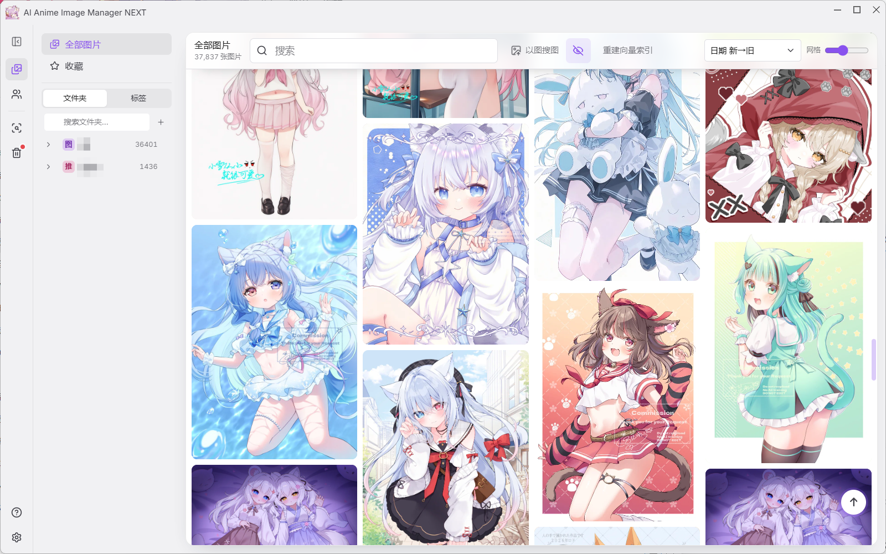
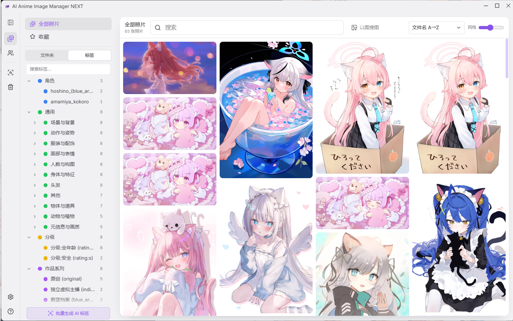
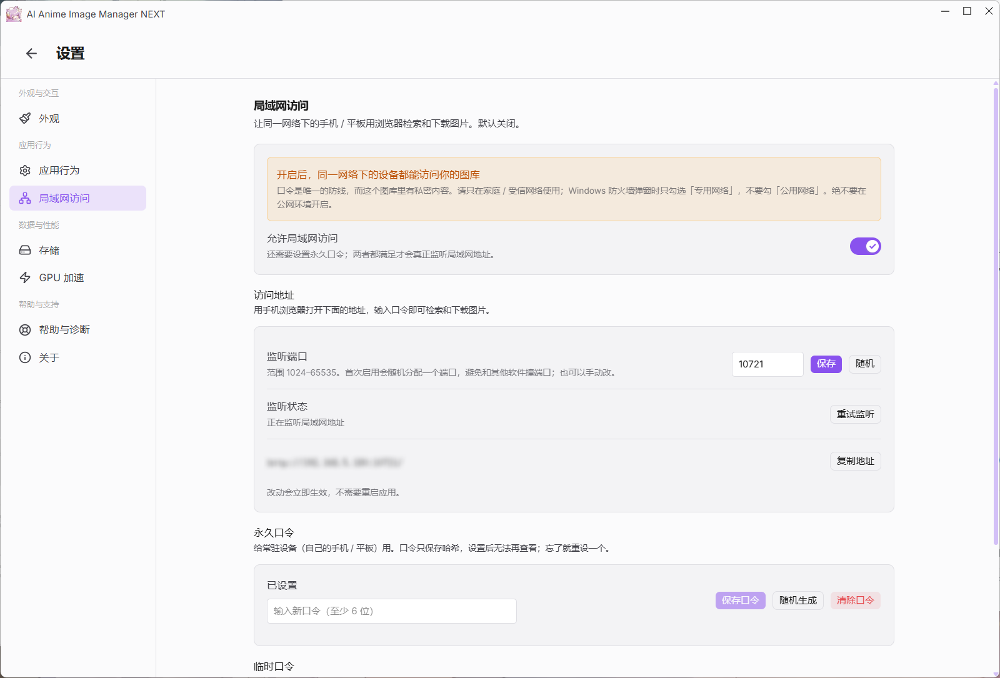

# AI Anime Image Manager NEXT（PixAI Tagger v1.0 · 自用修改）

> **本项目是「AI Image Manager」的修改版** —— 基于 [Uyoung666/ai-image-manager](https://github.com/Uyoung666/ai-image-manager) **v2.2.3** 修改而来。
> 上游采用 MIT License（Copyright © 2025 Luan Roger）；本仓库为个人自用修改版，与上游作者无关。

上游原始源码包 **不放进仓库**（50.9 MB 二进制大文件不进 git），单独放在 Release 里：

```
upstream/src/ai-image-manager-2.2.3/     ← 本版本的工作树（= 上游 + 补丁）
patches/next.patch                       ← 相对上游的补丁（干净解压上游源码 + git apply 可逐字节还原本工作树）
```

上游源码包（补丁验证基准，50.9 MB）：
<https://github.com/ASakurafoxA/AI-Anime-Image-Manager-NEXT/releases/download/upstream-v2.2.3/ai-image-manager-v2.2.3.zip>
SHA256 `b3679a512ea3298e2693a8d457b5485521aa7e69fe8e50874d89b0564fefc7ee`

## 功能



<p align="center"><em>主界面（与本地版一致）</em></p>


### 继承自上游的能力

| 功能 | 说明 |
|---|---|
| **图像管理** | 添加任意文件夹，自动索引、生成缩略图、按目录树浏览 |
| **重复图像识别** | 感知哈希比对，找出重复/近似重复的图，支持分组查看 |
| **以图搜图** | 用一张图去找相似的图 |
| **语义搜索** | 用自然语言描述画面找图 |
| **收藏 / 日期 / 文件夹筛选** | 按时间范围、按目录快速过滤 |

### 基础功能：动漫化标签体系（**PixAI Tagger v1.0**）

> 本表是 **NEXT 版（PixAI Tagger v1.0）** 的数据；本地版 / WD 用 WD14（词表 10,861、41 个/张、0.23 秒/张 CPU），详见 WD 仓库的 README ✓

> 上游的 AI 打标是为**真人摄影**设计的（SigLIP + 153 个英文概念），套在动漫插画上产出的是噪声
> （本机实测出现过「猫咪 42,632 张」）。本版一路换到 **PixAI Tagger v1.0**：词表 **30,877**、**六大类**，
> 数据截止 **2026 年 5 月**。
>
> 相比 WD14，它多认三样东西：**内容分级**（`rating:g/s/q/e`）、**作品系列**（如 `blue_archive` / `genshin_impact`）、
> **画风**（连画师风格都能认）；同人 / NSFW 角色命中率从 **10% → 30%**（本机实测）。

| 功能 | 说明 |
|---|---|
| **PixAI 自动打标** | **30,877** 个标签、**六大类**（通用 / 角色 / 作品系列 / 画风 / 元信息 / 分级）；平均 **46.5~58.5 个标签/张**，**0.59 秒/张**（GPU，本机实测）|
| **角色识别** | 直接认出是哪个角色，标签落库是中文（如 `初音未来 (hatsune_miku)`、`甘雨 (ganyu_(genshin_impact))`）|
| **通用标签中文化** | 落库为 `中文 (english)`，如 `长发 (long_hair)` → **中文和英文都能搜** |
| **标签二级分类** | **六大类**做顶级（通用 / 角色 / 作品系列 / 画风 / 元信息 / 分级），`通用` 内部再按 **13 个类型**建目录（头发 / 服装与配饰 / 面部与表情 …），不再平铺 |
| **只显示有图的标签** | 词表 **30,877** 个，只渲染库里真正用到的（不再把三万条平铺出来）|
| **标签黑名单** | 右键移入；集中到面板**底部固定区域**，不随标签树滚动；左键筛选、右键移出；**只影响显示不删数据** |
| **标签重命名** | 只改中文显示名，**英文标识自动保留在括号里** → 标签身份恒定，中英文检索始终有效 |
| **标签颜色** | 支持十六进制（`#f97316`、`#f93`）和 RGB（`rgb(249,115,22)`）；一级子树按归属共用颜色 |
| **批量打标签 / 断点续跑** | 多选批量加标签；「批量生成 AI 标签」**跳过已有自动标签**、可随时中断再续；界面没有「全部重打」入口；手动标签不受影响 |



<p align="center"><em>标签树：多了「分级」和「作品系列」两个 PixAI 新维度</em></p>

### 本版独有：其他改动

| 功能 | 说明 |
|---|---|
| **应用内回收站** | 删除时原文件移入 `<图库>/回收站/`，**30 天自动清理**，可恢复且**恢复后日期不变**；移动失败则不删库记录 |
| **界面精简** | 隐藏 仪表盘 / 相册 / 选片 / 云端 / 序列 / EXIF 筛选 / 6 个设置页（**代码保留，可恢复**）|
| **照片右键精简** | 去掉「导出」「添加到相册」；多选时**只剩「收藏」和「删除」**；新增右键「多选」 |
| **搜索界面精简** | 去掉「试试这样搜索」引导区与示例词（**保留**日期快捷筛选和标签建议）|
| **监听器精简** | 上游每个子文件夹建一个监听器（本机 4,414 个）→ **只监听根目录** |
| **开机增量补扫** | 关机期间存进目录的图，开机后补上（**默认关**，在 设置 → 应用行为 打开；目录 ≥3 万张时会先问一句） |
| **新图自动处理** | 软件开着时存进来的图会自动索引 + 打标 |
| **以图搜图重写** | 换成「**指纹（pHash）+ CLIP 语义**」两段式：同一张图（只改过分辨率/格式）**毫秒级命中、零误报**；改过/裁过的图交给 CLIP 找相似 （实测 1,400 次查询阈值 4 零误报）|


### 与 WD14 的对比（要点）

词表 **30,877**（WD14 10,861）；NSFW / 同人角色命中 **10% → 30%**；多出**内容分级 / 作品系列 / 画风**三个维度。
代价：打标 **0.59 秒/张**（WD14 0.23 秒）、模型 **解压后 1.86 GB**（WD14 361 MB），**可随时中断、下次从断点继续**。

> 首次建库建议先放一个子文件夹试跑，满意再跑全库；跑的时候机器可以继续用。

### 🖥️ 局域网查看（与 WD 版相同）

NEXT 版**同样带局域网访问功能，用法与 WD 版完全一致**：设置里配监听端口 +
**永久口令 / 临时口令**（临时可选 1/3/6/12/24 小时，默认关闭）；
同一网段内的手机、平板用浏览器打开 `http://<电脑IP>:<端口>` 即可检索并下载原图；
**网络端强制只读** —— 禁用删除和标签编辑，由服务端拒绝（不是只藏按钮）。

> 详细说明见 [AI-Anime-Image-Manager-WD](https://github.com/ASakurafoxA/AI-Anime-Image-Manager-WD)。



<p align="center"><em>局域网访问设置：端口 + 永久/临时双口令（默认关闭）</em></p>

## 校验补丁（可复现）

```powershell
# 1) 解压上游源码，得到 ai-image-manager-2.2.3/
# 2) 套补丁
cd ai-image-manager-2.2.3
git apply --whitespace=nowarn ../patches/next.patch
# 3) 与 upstream/src/ai-image-manager-2.2.3/ 逐字节比对 → 应完全一致
```
本补丁已按上面流程验收：**逐字节全部一致，`git apply` 退出码 0**。

## 最近更新

**当前版本 `2.2.3.80`（2026-11-16）**：角色识别入口合并成一个下拉（发现新角色 / 给已有角色补漏 / 多人图只认出一个角色）；
多人图补名改成两排缩略图；角色封面可右键模糊化；图集操作栏搬到页面顶部；
补漏的逐角色比对搬进独立进程（300 个角色 **24.5 秒 → 1.5 秒**）。

完整变更见 [CHANGELOG.md](CHANGELOG.md)；安装包在下方 Releases。

## 下载

**两种拿法**：Release 页直接下（推荐，附校验信息），或网盘 <https://pan.baidu.com/s/1jDBvv4tL9v5_BgYhRDJcGQ?pwd=6666> 提取码 `6666`（安装包与 PixAI 模型在同一目录）。

### 1. 安装包（MSI）

| 版本 | 文件名 | 大约 |
|---|---|---|
| **NEXT**（本仓库，PixAI 打标） | `AI Anime Image Manager NEXT-2.2.3.80.msi` | 336 MB |
| WD | `AI Anime Image Manager WD-2.2.3.80.msi` | 665 MB |
| 本地版 | `AI Anime Image Manager-2.2.3.80.msi` | 665 MB |

都在 [Releases](https://github.com/ASakurafoxA/AI-Anime-Image-Manager-NEXT/releases) 的最新版页面（**只保留最新一个安装包**）；
每个仓库根目录 `校验信息.md` 里有 **MD5 / SHA-256**，下完先核对。

> ⚠️ 版本号是 **2.2.3.x**（每次构建自增）：**直接装新包会原地升级**；同一个包重复双击会进「更改 / 修复 / 删除」维护界面。卸载不会删图库和设置。

### 2. 模型（两个，别搞混）

| 模型 | 谁需要 | 大小 | 从哪里下载 | 解压/放到 |
|---|---|---|---|---|
| **PixAI 打标模型**（给图片打标签） | **只有 NEXT** | **压缩包 1.72 GB / 解压后 1.86 GB** | ① Release 最早那版 [`v2.2.3` 的 `pixai-tagger-v1.0.zip`](https://github.com/ASakurafoxA/AI-Anime-Image-Manager-NEXT/releases/download/v2.2.3/pixai-tagger-v1.0.zip)<br>② 网盘（与安装包同一目录）：<https://pan.baidu.com/s/1jDBvv4tL9v5_BgYhRDJcGQ?pwd=6666> 提取码 `6666` | `<图库>\models\pixai-tagger-v1.0\` |
| **CCIP 角色识别模型**（认角色用） | 三版**共用** | **压缩包 339 MB / 解压后 366 MB** | ① Release 最新版附件 `CCIP-Model-20261018.zip`<br>② 网盘：<https://pan.baidu.com/s/1ZBRJIwIB7g1vuiTfoed4fA?pwd=6666> 提取码 `6666` | `<图库>\models\ccip\model_feat.onnx` |

- **中文 CLIP（语义搜图）已随安装包提供**，不用单独下。
- 两个模型**不能互相替代**：PixAI 负责"打标签"，CCIP 负责"认角色"；WD / 本地版用包内的 WD14 打标，**不需要** PixAI。
- 参考：WD14 上游 <https://huggingface.co/SmilingWolf/wd-vit-tagger-v3>；中文 CLIP 上游 <https://huggingface.co/Xenova/chinese-clip-vit-base-patch16>
- 放法细节：[MODELS.md](MODELS.md) 的「CCIP 模型（角色识别）怎么放」一节

## 构建

```powershell
npm install
# 1) 打包（解出完整的运行目录）
node node_modules/@electron-forge/cli/dist/electron-forge.js package --platform win32 --arch x64
# 2) 打 MSI（自写 WiX 源；具体参数由维护者本地保存）
powershell -NoProfile -ExecutionPolicy Bypass -File scripts\build-msi-wix.ps1 `
  -ProductName "AI Anime Image Manager NEXT" -ExeName "ai-anime-image-manager-next.exe" -UpgradeCode "2636577f-93de-46c0-8217-f4a360fa2ebf"
# 版本号默认每次构建自增（要固定再加 -Version 2.2.3.80）
```

> 产物在 `msi-out/`。**不要**用 `make --targets @electron-forge/maker-wix`：它打出来的包
> 快捷方式没有图标、目标指向不存在的壳 exe、装完目录是空的（2026-10-18 实测）。
> 中文/空格路径不影响这套脚本（`heat` + `candle` + `light` 都能处理），但如果路径太长仍建议放 `F:\` 根下。

## 不包含什么（体积原因）

`node_modules/`、`out/`、`models-release/` 都是可再生成的；模型权重（`models/**/*.onnx`，几百 MB 到 1.8 GB）
与安装包（`*.msi` / `*.nupkg`）不在仓库里 —— 它们走 Releases / 网盘分发。

## 完整使用说明

装好之后怎么用（第一次打开、加照片、打标、搜索、局域网手机端、常见问题）见 **[完整使用说明.md](完整使用说明.md)**；想先看「三个版本有什么区别、我这台机器要跑多久」，看 **[快速上手.md](快速上手.md)**。

## 许可

上游为 MIT，本仓库的修改同样以 MIT 提供，**完整许可文本见 [`LICENSE`](LICENSE)**（上游原始许可另见 `upstream/src/ai-image-manager-2.2.3/LICENSE`）。

`LICENSE` 开头两行版权分别是上游作者与本仓库：

```
Copyright (c) 2025 Luan Roger      ← 上游 AI Image Manager 原作者
Copyright (c) 2026 ASakurafoxA     ← 本仓库的修改部分
```

这是个人自用修改版，与上游作者无关。